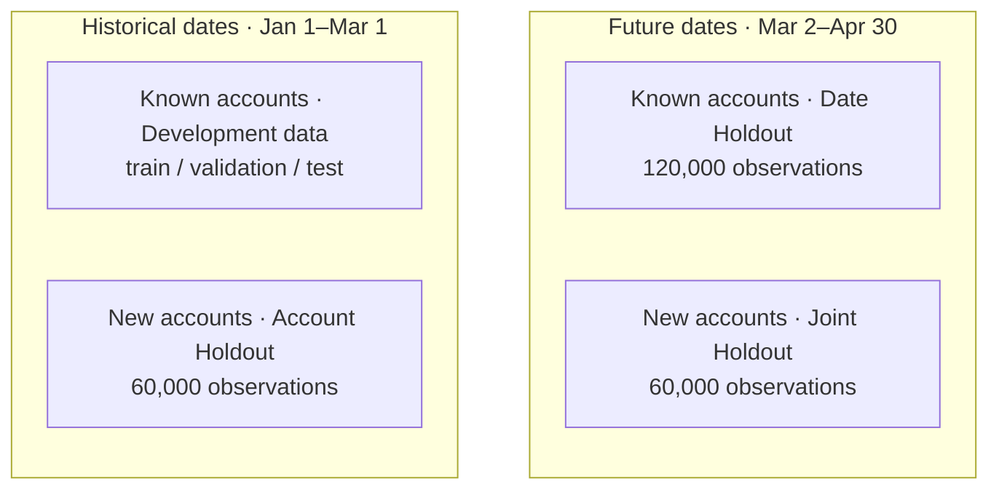
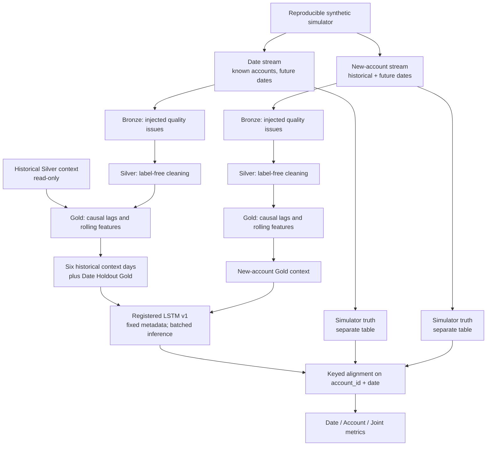
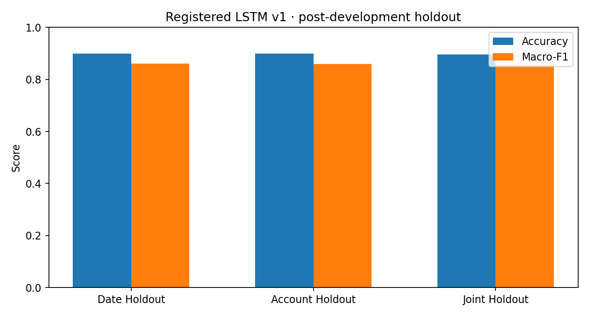
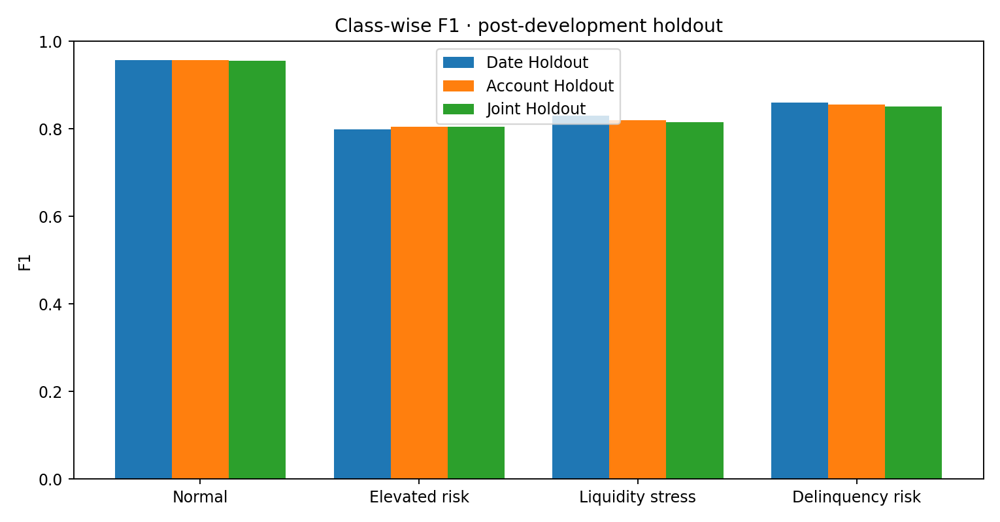
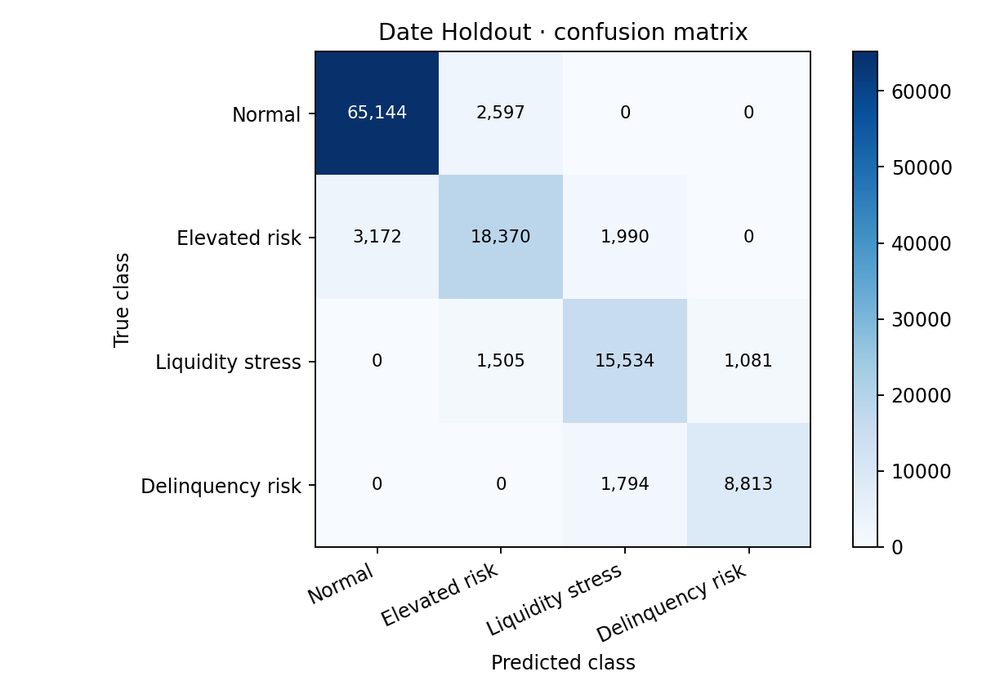
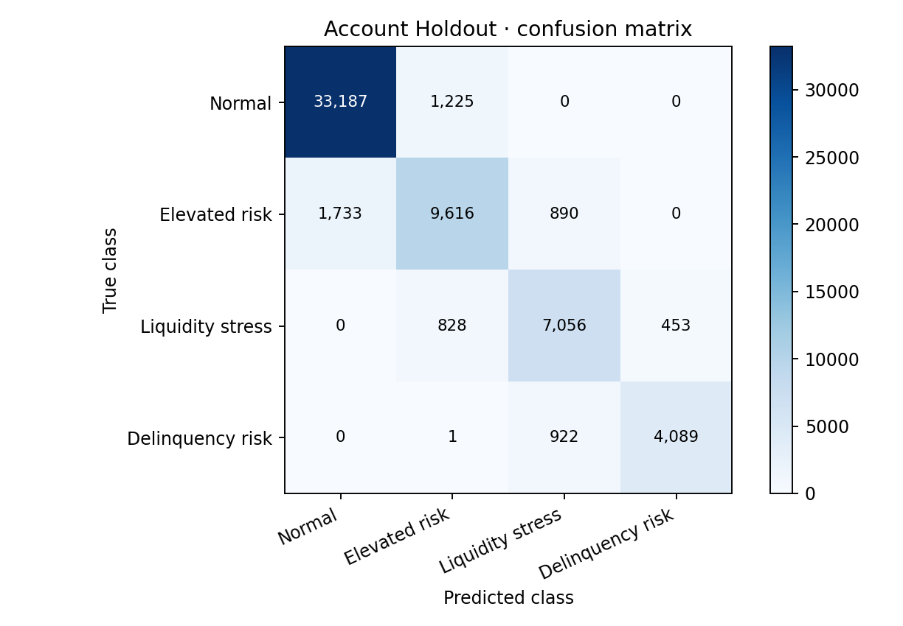
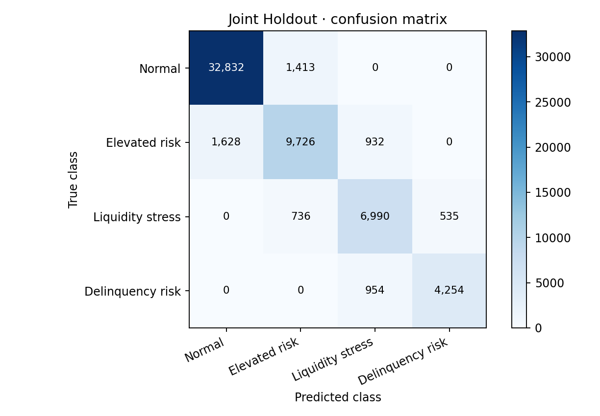

# Post-development holdout pipeline and evaluation

## Scope and terminology

**Holdout** here means an **additional, post-development synthetic evaluation dataset**. It is **not** the test split in the original model-development train/validation/test workflow. The pinned registered model, `finance_ml.models.lstm_risk_classifier` **version 1**, is evaluated without retraining or refitting any preprocessing statistics.

The three display names used consistently throughout this project are:

| Display name | Account dimension | Date dimension | Observations |
|---|---|---|---:|
| **Date Holdout** | 2,000 known accounts | Future dates (2026-03-02 through 2026-04-30) | 120,000 |
| **Account Holdout** | 1,000 new accounts | Historical dates (2026-01-01 through 2026-03-01) | 60,000 |
| **Joint Holdout** | 1,000 new accounts | Future dates (2026-03-02 through 2026-04-30) | 60,000 |

### Account × date evaluation space

**Reading the four quadrants:** columns represent **historical versus future dates**; rows represent **known versus new accounts**. The top-left quadrant belongs to model development, not the post-development holdout. The other three quadrants are the three evaluation cohorts. The table above provides the unambiguous two-dimensional layout.

| Account identity ↓ / Date → | Historical · Jan 1–Mar 1 | Future · Mar 2–Apr 30 |
|---|---|---|
| **Known accounts** | **Development data** (train/validation/test) | **Date Holdout** |
| **New accounts** | **Account Holdout** | **Joint Holdout** |

## Reproducible simulation

- **Historical:** 2,000 accounts × 60 days = 120,000 pristine simulator records.
- **Date Holdout:** same 2,000 accounts × 60 additional days = 120,000 pristine simulator records.
- **New-account stream:** 1,000 previously unseen accounts × 120 days = 120,000 pristine simulator records, separated into Account and Joint Holdouts for evaluation.
- Simulator seed: `42`; temporal corruption seed: `124`; new-account corruption seed: `125`.
- Original historical records were replayed exactly using SHA-256 `8654cb318f6e130d9d1b02f4bea02b2e762e9ebdc07809332af5dac345daa940` (the hash of the development data table), with the recorded pandas hashing procedure and tested runtime.
- Quality injection creates 0.5% duplicate Bronze account/date records and introduces missing/invalid predictors. Clean simulation truth is preserved separately.

The model is trained on neither the new-account stream nor the future observations. **Account Holdout and Joint Holdout share new-account trajectories**; they are distinct *evaluation cells*, not independent sets of accounts.

## Data and inference architecture

Gold feature engineering reuses `build_gold_features()` on appropriately contextualized label-free Silver data. The registered inference pipeline applies **saved** numeric imputations, categorical encoding, and scaling. Seven-timestep sequence windows are scored with stride 1 and `boundary_width=0`; overlapping probability estimates are aggregated to account/date observations. Batching by **50 accounts** avoids materializing the full sequence tensor at once; inference still holds the selected prediction dictionaries in the notebook for evaluation.

## Unity Catalog tables

| Group | Layer | Table |
|---|---|---|
| Date | Bronze | `finance_ml.bronze.account_events_temporal_holdout` |
| Date | Silver | `finance_ml.silver.account_events_temporal_holdout_clean` |
| Date | Gold | `finance_ml.gold.account_features_temporal_holdout` |
| Date | Ground truth | `finance_ml.gold.account_labels_temporal_holdout` |
| New accounts | Bronze | `finance_ml.bronze.account_events_account_holdout` |
| New accounts | Silver | `finance_ml.silver.account_events_account_holdout_clean` |
| New accounts | Gold | `finance_ml.gold.account_features_account_holdout` |
| New accounts | Ground truth | `finance_ml.gold.account_labels_account_holdout` |

Both Bronze tables contain **120,600 records** (including 600 duplicates). Each corresponding Silver, Gold, and truth table contains **120,000 unique account/date records**. Temporal inference context includes **12,000 historical context records** in addition to 120,000 future Gold records.

The original historical Bronze, Silver and Gold tables and UC model version 1 were left unchanged. Writes are explicit, and new tables should be created only when absent. The eight-table operation is *not atomic*; partial success requires inspection rather than automatic deletion or overwrite.

## Evaluation protocol

Predictions and simulator labels are matched **one-to-one on `(account_id, date)`**, with no unmatched rows permitted. All **240,000** post-development holdout observations have predictions. Account Holdout uses the new accounts' first 60 dates; Joint Holdout uses those same accounts' next 60 dates, with earlier account observations available for sequence context.

Scores are **observed synthetic-data results**, not out-of-domain banking benchmarks. Macro-F1 gives equal weight to all four risk states. The matrices below use **rows = true class, columns = predicted class**.

## Observed results · registered LSTM v1

| Holdout | Accounts | Observations | Accuracy | Macro-F1 |
|---|---:|---:|---:|---:|
| Date Holdout | 2,000 | 120,000 | 0.8988 | **0.8615** |
| Account Holdout | 1,000 | 60,000 | 0.8991 | **0.8595** |
| Joint Holdout | 1,000 | 60,000 | 0.8967 | **0.8569** |

### Class-wise F1

| Risk state | Date Holdout | Account Holdout | Joint Holdout |
|---|---:|---:|---:|
| Normal | 0.9576 | 0.9573 | 0.9557 |
| Elevated risk | 0.7986 | 0.8044 | 0.8051 |
| Liquidity stress | 0.8299 | 0.8202 | 0.8158 |
| Delinquency risk | 0.8598 | 0.8560 | 0.8511 |

### Confusion matrices

**Date Holdout**

**Account Holdout**

**Joint Holdout**

The largest mistakes are predominantly between neighboring simulator-defined risk states. Joint Holdout macro-F1 is **0.0046** lower than Date Holdout macro-F1, an observed difference rather than evidence of statistical equivalence or significant deterioration.

## Interpretation and limitations

1. All three cohorts originate from the **same synthetic simulator**. This assesses controlled account and temporal generalization, not transfer to independent banking populations or operational production conditions.
2. The new-account cohort contains **previously unseen account IDs**, but it is **not a zero-history cold-start experiment**: preceding days are available to score later timestamps.
3. Account-day observations are correlated within accounts. Confidence intervals and differences between cohorts should account for account-level clustering (for example, account-level bootstrap).
4. Synthetic risk labels are determined by the simulator's stress mechanism; adjacent state errors are interpretable in that context.
5. Predictions were evaluated after model registration, using fixed preprocessing metadata. The original development test split remains conceptually separate.
6. Charts use the **rounded numerical results provided by the completed Databricks evaluation**. For exact-precision regeneration, run notebook 10 with inference enabled and export its evaluation figures.

## Running notebook 10

Notebook: [`../notebooks/10_build_future.ipynb`](../notebooks/10_build_future.ipynb).

- **Reuse mode:** read the eight verified persisted tables without regenerating or rewriting holdout data.
- **Create mode:** only when all eight destination tables are absent, with explicit table safety checks. Never rerun creation on populated destinations.
- **Inference:** opt-in account-batched inference, 50 accounts per batch, using the registered model version 1.
- **Figure export:** opt-in; save into `docs/images/` and review before committing.
- No registered-model changes, refitting, or original-table overwrites occur during evaluation.

The repository should retain the verified holdout pipeline, notebook, tests, figures and documentation. Remove obsolete approximate-future generation and its tests/documentation only after reference and regression checks.
