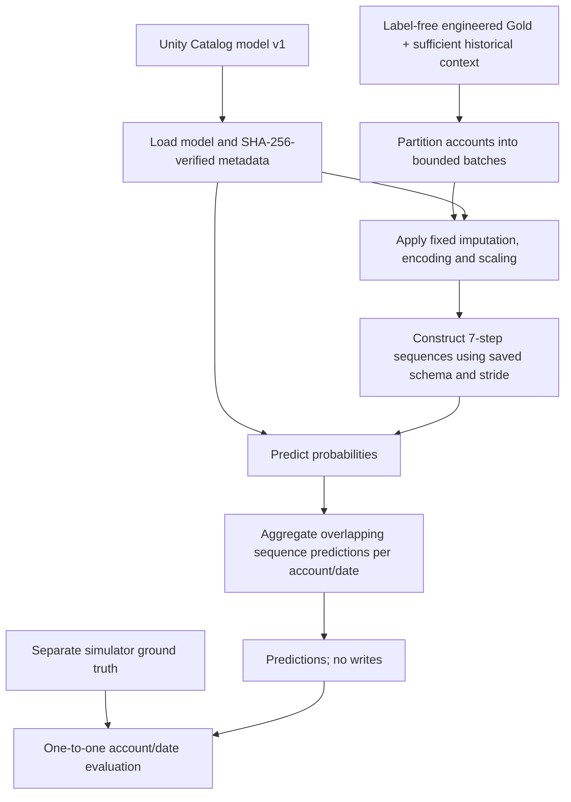
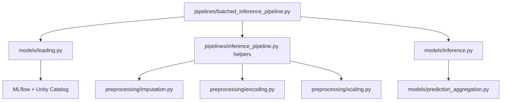

# Model inference pipeline — developer and user guide

## Overview

This pipeline performs **batch inference** with a pinned Unity Catalog model version and its SHA-256-verified preprocessing metadata. It requires engineered Gold features, does not train or refit preprocessing, and does not overwrite historical development tables. The project supports single-call inference and **account-batched inference** to bound driver-side sequence-memory usage.

The currently evaluated model is `finance_ml.models.lstm_risk_classifier`, version `1`. See [post-development holdout documentation](holdout_data_pipeline.md) for the account–date evaluation design, recorded metrics, charts, and limitations.

## Architecture



## Python dependency map



## Model and preprocessing contract

Model-version tags identify the preprocessing metadata's source run, artifact path, and SHA-256. The loader checks the metadata checksum and source run, and loads the pinned Keras model. **Version 1 preprocessing metadata was reconstructed**, not captured at original training time; this limitation should remain visible.

The input requires the engineered Gold numeric and categorical features together with `account_id` and `date`. Risk targets (`risk_state`, `risk_state_name`) are excluded from inference inputs. Saved medians, categorical levels, scaler parameters and the **ordered feature schema** are reused without fitting on holdout data.

The model operates on seven-day sequences with stride 1 for the registered configuration. `boundary_width=0` retains predictions at both ends of windows for complete account/date coverage when sufficient context is available. This differs from the saved default boundary trimming. Overlapping per-timestep probabilities are averaged. Each aggregated record contains `group`, `time`, `mean_probabilities`, `predicted_class`, and `n_contributions`.

## Databricks usage

Notebook [`../notebooks/10_build_future.ipynb`](../notebooks/10_build_future.ipynb) orchestrates persistence-safe reuse, batched inference and three post-development holdout evaluations. Use its **reuse** mode for the eight existing holdout tables; do not rerun table creation against populated destinations.

Single-call inference remains available for bounded inputs:

```python
import mlflow
from finance_ml.pipelines.inference_pipeline import run_inference_pipeline

mlflow.set_tracking_uri("databricks")
mlflow.set_registry_uri("databricks-uc")
result = run_inference_pipeline(
    config={"model_version": "1", "boundary_width": 0},
    spark=spark,
    gold_df=bounded_context_df,
)
```

For a larger dataset, use the batched pipeline. It accepts a Spark Gold/context DataFrame directly; unlike `run_inference_pipeline`, it does **not** require `spark=` as an argument:

```python
from finance_ml.pipelines.batched_inference_pipeline import (
    run_batched_inference_pipeline,
)

result = run_batched_inference_pipeline(
    gold_context_df,
    config={"model_version": "1", "boundary_width": 0},
    accounts_per_batch=50,
)
```

`on_batch` may be supplied to consume predictions incrementally; the notebook uses it to collect evaluation-period predictions. The pinned model loads **once per invocation**, not once per account batch. When evaluating the two holdout streams separately, it loads once per stream.

The batch implementation bounds **sequence tensors** in memory but is not distributed model inference. Accumulating all prediction dictionaries still uses driver memory. There is no prediction-table persistence or streaming serving endpoint yet.

## Evaluation results

The registered LSTM v1 was evaluated on **240,000** unique synthetic holdout account/date observations, aligned one-to-one with ground-truth labels. The Date Holdout uses known accounts on later dates; the Account Holdout uses new accounts on historical dates; the Joint Holdout uses new accounts on later dates.

| Holdout | Observations | Accuracy | Macro-F1 |
|---|---:|---:|---:|
| Date Holdout | 120,000 | 0.8988 | 0.8615 |
| Account Holdout | 60,000 | 0.8991 | 0.8595 |
| Joint Holdout | 60,000 | 0.8967 | 0.8569 |

See [figures and per-class analysis](holdout_data_pipeline.md#observed-results--registered-lstm-v1). These are descriptive results on the same synthetic data-generating process, not external real-world validation. They do not establish statistical equivalence between cohorts.

## VS Code / Windows

Activate the project environment and install dependencies using `python -m pip install -e ".[dev]"`. Configure Databricks authentication and MLflow tracking/registry access. For remote Spark execution, install a compatible Databricks Connect version separately and provide its session where needed. The batch pipeline accepts a Gold Spark DataFrame; connector-based loading alone does not replace Spark processing. Never commit local tokens or `.env` files.

## Implementation limitations

- Batch execution, not streaming or distributed inference; account groups are collected to driver memory in bounded batches.
- The Gold features must use the same causal engineering rules as development, with historical lookback context for later dates.
- The existing model requires at least seven records per account to construct one sequence.
- Unknown categorical levels use the saved encoder's handling policy; missing required columns fail fast.
- Version 1's saved preprocessing metadata has reconstructed provenance.
- Model outputs have been validated in Databricks for both holdout streams; real-bank generalization, drift monitoring, production scheduling, and prediction-table storage remain out of scope.

## Tests

```powershell
python -m pytest tests/test_loading.py tests/test_inference.py tests/test_inference_pipeline.py tests/test_batched_inference_pipeline.py -q
python -m pytest -q
```
